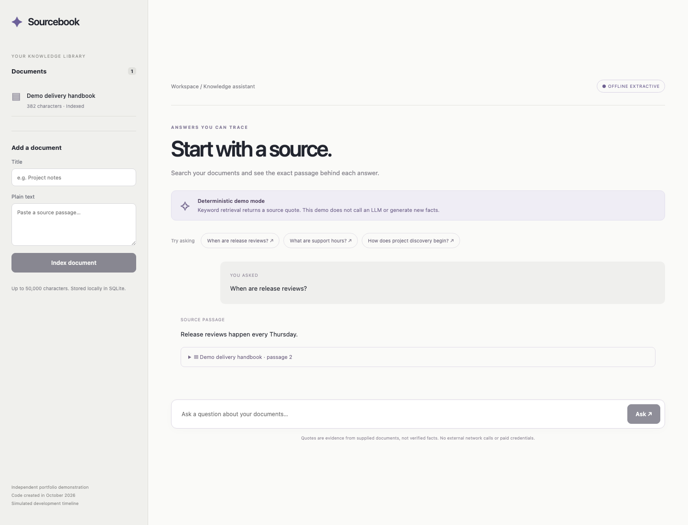

# Full-stack knowledge assistant

A React document library and chat interface backed by FastAPI and SQLite. It ingests plain text, retrieves the closest lexical passage, and returns an exact quote with its document citation. **Offline extractive mode calls no LLM and generates no new facts.** It works without credentials or paid services.



## Simulated history

This code was created in **October 2026**. Commit dates are a **simulated development timeline**, not evidence of historical work or employment. This independent agency-style portfolio demo has no actual client or employer. See [TIMELINE.md](TIMELINE.md).

Python 3.11, FastAPI, React 19.3, Vite 8.3, Rolldown, and locked dependency versions are modern reconstruction choices; some postdate the illustrative 2025–2026 commits. No unsupported historical implementation or production claims are intended.

## Run locally

Requirements: Python 3.11 and Node.js 24 LTS (minimum 22.12).

From the repository root:

```sh
python3 -m venv .venv
.venv/bin/pip install -r backend/requirements.lock.txt
cd backend
../.venv/bin/python -m uvicorn app.main:create_app --factory --host 127.0.0.1 --port 8102
```

In a second terminal from the repository root:

```sh
cd frontend
npm ci
npm run dev
```

Open the URL printed by Vite, normally http://127.0.0.1:5173. The `/api` proxy forwards to port 8102. API documentation: http://127.0.0.1:8102/docs. A fictional demo handbook seeds the database idempotently. Documents persist across restarts in ignored `data/knowledge.sqlite`. Stop the API and remove that file to reset local demo data.

## API

- `GET /api/documents` lists `{id,title,characters}` metadata. An empty library returns `[]`.
- `POST /api/documents` with `{title,text}` ingests UTF-8 plain text represented in JSON. Title: 1–120 characters; text: 1–50,000. Whitespace-only values are rejected. Returns 201 and document metadata; identical title and text reuse the same stable ID.
- `POST /api/ask` with `{question}` returns `{answer,citations,supported,mode}`. Question: 1–500 characters with meaningful search terms. Unknown routes return 404. Schema failures return 422; domain validation returns 400.

```sh
curl http://127.0.0.1:8102/api/ask \
  -H 'Content-Type: application/json' \
  -d '{"question":"When are release reviews?"}'
```

The result has `mode: "offline-extractive"`, answer `"Release reviews happen every Thursday."`, and a citation carrying `document_id`, `title`, zero-based `chunk`, and exact `quote`. Unsupported questions return `supported: false`, no citations, and a visible no-source message. No external search occurs.

## Architecture and retrieval

SQLite commits ingestion atomically. A content-derived ID deduplicates submissions. An immediate transaction enforces the **100-document limit**, including concurrent requests. SQL values use bound parameters. SQLite connections are opened per operation rather than shared across threads.

Retrieval splits text at punctuation and line boundaries into passages, lowercases ASCII word tokens, removes a small stopword set, and ranks passages by query-term coverage. At least half of the meaningful query terms must match. Ties use stable document IDs and passage order. The best passage is returned verbatim with its source; no paraphrasing or semantic inference is performed. Chunk indices are sentence/passage ordinals, not page numbers.

`AnswerProvider` defines the provider boundary. `ExtractiveProvider` is the only included implementation and the public API always uses it. A real model adapter would require its own citation validation, evaluation, timeout, and secret handling before use. No OpenAI integration is claimed. A Node gateway adds no useful session boundary to this local demo and is omitted.

## Evaluation and verification

```sh
cd backend
../.venv/bin/python -m pytest -q
# Only the cited-answer evaluation and concurrency checks:
../.venv/bin/python -m pytest -q tests/test_evaluation.py
cd ../frontend
npm ci
npm run build
```

`eval/cases.json` defines five reproducible questions, including unsupported budget and lunar-temperature questions. Tests check expected support/refusal, answer phrases, document identity, exact quote membership in the original source, and absence of citations for refusal. Citation support is measured against supplied text; source truth and semantic answer relevance are separate concerns.

Verified locally: **32 Python tests** including five fixture evaluation cases and concurrent ingestion checks; a production build; and headless Chromium checks for the seeded library, a cited answer, refusal, document ingestion, a 390px mobile viewport, and network error handling without page errors. The screenshot comes from the running demo. Fresh verification on October 7, 2026 used Python 3.11 and Node 26. Both suites emitted one upstream Starlette/AnyIO deprecation warning; no tests failed. `backend/requirements.lock.txt` records the exact resolved Python dependency versions; `requirements.txt` lists direct requirements. GitHub Actions runs the full suite and production build; remote CI execution is not asserted here.

## Security and practical limits

This local demo has no authentication or tenant isolation. Supplied documents are untrusted data, displayed as escaped React text. No templates, commands, or model instructions are executed. The demo performs no external model calls or URL fetches. Do not enter confidential content into a public deployment. Plain SQLite storage is not encrypted. A production service needs authentication, per-user storage, proxy body limits, rate limits, retention/deletion controls, monitoring, and dependency review.

Character and document counts bound the indexed corpus; the server does not independently limit raw HTTP request bytes before JSON parsing. Retrieval scans the small corpus and uses lexical similarity, not embeddings, so synonyms may fail and a shared keyword can retrieve a contextually irrelevant quote. Long punctuation-free passages can produce long answers. Only ASCII tokenization is implemented. Citation inclusion proves textual provenance, not factual correctness. This is an explicit retrieval baseline for evaluation, not a claim of LLM reasoning quality. `.env` and local data are ignored; real credentials are unnecessary. Browser checks were local and do not constitute a comprehensive accessibility or production deployment audit.
